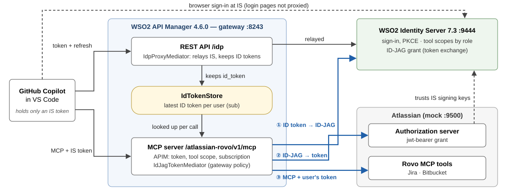
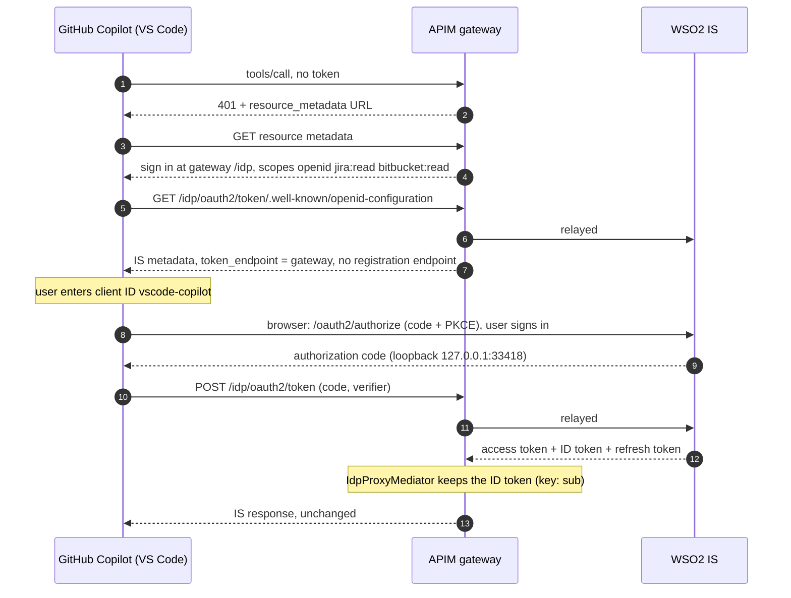
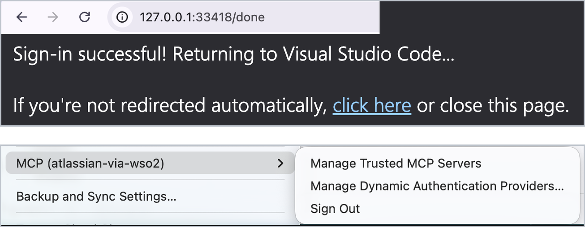
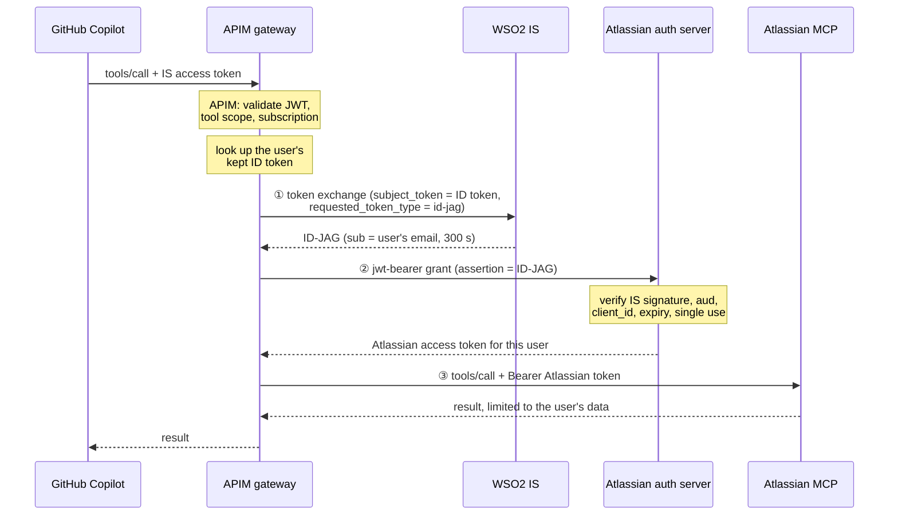
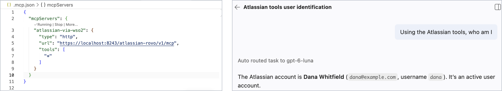

# GitHub Copilot → WSO2 API Manager → Atlassian, with ID-JAG

GitHub Copilot calls Atlassian's MCP tools (Jira, Bitbucket) through the
**WSO2 API Manager** gateway. Each developer signs in once with **WSO2 Identity
Server**. On every tool call the gateway turns that sign-in into a short-lived
Atlassian token **for that developer**, using **ID-JAG** token exchange
([Identity Assertion JWT Authorization Grant](https://datatracker.ietf.org/doc/draft-ietf-oauth-identity-assertion-authz-grant/),
the assertion that
[MCP enterprise-managed authorization](https://modelcontextprotocol.io/extensions/auth/enterprise-managed-authorization)
builds on).

- **Copilot never holds an Atlassian credential.** It holds only an IS access
  token, and the gateway governs every call: authentication, per-tool scopes,
  subscription and throttling.
- **No consent screen at Atlassian.** Atlassian trusts WSO2 IS as an identity
  issuer and accepts an ID-JAG that IS signed.
- **Atlassian only ever sees per-user tokens**, so each developer sees only
  their own projects and repositories.

Everything runs locally: WSO2 IS 7.3.0, WSO2 API Manager 4.6.0, and a small
Atlassian stand-in (the "mock") that implements Atlassian's side of the flow.

**Contents:** [Architecture](#architecture) · [How it works](#how-it-works) ·
[Repository layout](#repository-layout) · [Prerequisites](#prerequisites) ·
[Set it up](#set-it-up) · [Try it in VS Code](#try-it-in-vs-code) ·
[Validate with Postman](#validate-with-postman) ·
[What the logs show](#what-the-logs-show) · [Design notes](#design-notes) ·
[Limitations](#limitations-and-next-steps) · [Troubleshooting](#troubleshooting) ·
[Clean up](#clean-up)

---

## Architecture



| Component | Role |
|---|---|
| **GitHub Copilot** (VS Code) | MCP client. Signs in with OAuth 2.0 authorization code + PKCE as the public client `vscode-copilot`. |
| **WSO2 API Manager 4.6.0** gateway | Fronts the MCP server `AtlassianRovo`. Validates the IS token, checks the tool's scope, subscription and throttling, then runs the ID-JAG exchange. Adds a REST API `/idp` that relays IS's sign-in metadata and token endpoint, so the gateway sees every token response and keeps each user's ID token. |
| **WSO2 Identity Server 7.3.0** | Sign-in. API Manager's Key Manager (JWT access tokens). Grants tool scopes by role. Issues ID-JAGs through a custom token exchange grant. |
| **Atlassian (mock)** | An authorization server that redeems ID-JAGs (RFC 7523 jwt-bearer grant) after checking IS's signature, plus 9 read-only Jira and Bitbucket MCP tools that answer per user. |

Three trust relationships make it work:

1. **The ID token's audience includes the gateway's client.** IS issues an
   ID-JAG only to a client the ID token was issued to, so Copilot's app adds
   `wso2-mcp-gateway` to its ID token audience:
   `aud = ["vscode-copilot", "wso2-mcp-gateway"]`.
2. **Atlassian trusts WSO2 IS as an issuer** (issuer and JWKS URL), and knows the
   gateway as a client. The ID-JAG's `client_id` is the client that made the
   exchange, so the gateway uses **one client ID at both servers**
   (`wso2-mcp-gateway`), with a different secret at each.
3. **The gateway sees every token response.** Copilot cannot send its ID token
   to an MCP server, so the gateway asks Copilot to sign in through its own
   `/idp`, which relays IS and keeps each user's latest ID token.

## How it works

### Sign-in, once per session



| Steps | What happens | Why |
|---|---|---|
| 1–2 | Copilot calls a tool without a token; APIM answers 401 with the resource-metadata URL. `initialize` and `tools/list` work anonymously. | Standard MCP authorization discovery (RFC 9728). |
| 3–4 | The gateway policy answers the resource metadata itself, before APIM does: sign in at `https://localhost:8243/idp/oauth2/token`, with scopes `openid jira:read bitbucket:read`. | APIM's own answer names no sign-in server and never asks for `openid`, and without `openid` there is no ID token. |
| 5–7 | The `/idp` API relays IS's OIDC metadata, with `token_endpoint` pointed at the gateway and the registration endpoint removed. | Every token and refresh call now passes the gateway. With no dynamic registration on offer, VS Code asks for a client ID. |
| 8–9 | The browser signs in at IS directly; the code returns to VS Code's loopback listener. | IS's login pages are not proxied. |
| 10–13 | VS Code exchanges the code at the gateway. IS returns access, ID and refresh tokens; the gateway keeps the ID token under the user's `sub` and passes IS's response on unchanged. | The ID token is now available for every tool call. A refresh through `/idp` replaces it with IS's new one. |



*The browser hands the code back to VS Code (top); VS Code then holds a session
for the MCP server (bottom).*

### Every tool call



| Hop | Request | Checks |
|---|---|---|
| APIM | `tools/call` with the IS access token | JWT signature and issuer (Key Manager `WSO2IS`), the subscription of Copilot's application, the tool's scope (`jira:read` for Jira tools, `bitbucket:read` for Bitbucket), throttling |
| Mediator | Find the user's ID token in `IdTokenStore` by `sub` | None kept → 401 ("sign in again"). Application (`client_credentials`) tokens → 403 |
| ① | IS token endpoint: RFC 8693 exchange, `subject_token` = ID token, `requested_token_type` = `urn:ietf:params:oauth:token-type:id-jag`, `audience` = Atlassian's authorization server | IS: the ID token's signature and expiry, and that its audience includes `wso2-mcp-gateway`. Gateway: the response is `typ: oauth-id-jag+jwt`, with a single `aud`, unexpired |
| ② | Atlassian token endpoint: RFC 7523 jwt-bearer, `assertion` = ID-JAG | Atlassian: IS signature (JWKS), `iss`, `aud`, `client_id` = the authenticated client, expiry, `jti` single use; `sub` (an email) mapped to the account |
| ③ | The MCP request with `Authorization: Bearer <Atlassian token>` | The gateway's token is removed first; Atlassian returns only that user's data |



*The workspace configures only the gateway URL (left); Copilot answers from
dana's own Atlassian account (right).*

## Repository layout

```text
├── README.md               this guide
├── setup/                  put the two WSO2 zips here; install.sh unpacks them here
├── code/
│   ├── idjag-grant/        WSO2 IS extension: ID token → ID-JAG token exchange grant (Java)
│   ├── apim-idjag-policy/  WSO2 API Manager gateway mediators + policy definitions (Java)
│   │     IdJagTokenMediator   on tools/call: ID token → ID-JAG → Atlassian token
│   │     IdpProxyMediator     on /idp: relays IS, keeps each user's ID token
│   │     IdTokenStore         latest ID token per user
│   └── atlassian-mock/     Atlassian stand-in: jwt-bearer token endpoint + 9 MCP tools (Python)
├── scripts/
│   ├── install.sh          one-time, offline: unpack, build, configure product files, dev CA
│   ├── start.sh, stop.sh   WSO2 IS, API Manager, the mock
│   ├── configure.sh        users, apps, scopes, Key Manager, MCP server, policies, /idp (REST APIs)
│   └── verify.sh           plays Copilot's sign-in and tool calls with curl
├── copilot-workspace/      open this folder in VS Code (.mcp.json → the gateway)
├── postman/                the same path, one request at a time
└── images/
```

## Prerequisites

**Tools** (tested on macOS):

| Tool | Version |
|---|---|
| JDK | 17 or newer (tested with 21) |
| Apache Maven | 3.9 |
| Python | 3.11 or newer |
| `jq`, `curl`, `openssl`, `unzip` | any recent |
| VS Code with GitHub Copilot | Copilot Chat in agent mode, with MCP support (tested with VS Code 1.141) |

**WSO2 products.** Download the two zips and put them into [`setup/`](setup/):

| Product | Download | File in `setup/` |
|---|---|---|
| WSO2 Identity Server 7.3.0 | [wso2.com/identity-server](https://wso2.com/identity-server/) | `wso2is-7.3.0*.zip` |
| WSO2 API Manager 4.6.0 | [wso2.com/api-manager](https://wso2.com/api-manager/) | `wso2am-4.6.0*.zip` |

```text
setup/
├── wso2is-7.3.0.zip      (an updated pack, e.g. wso2is-7.3.0.9.zip, works too)
└── wso2am-4.6.0.zip      (e.g. wso2am-4.6.0.33.zip)
```

Tested with updated packs `wso2is-7.3.0.9` and `wso2am-4.6.0.33`. The Java code
is compiled against the jars inside your packs: `install.sh` reads their
versions from the pack, so other update levels of 7.3.0 and 4.6.0 work without
changes.

**Ports:** 9444 (WSO2 IS, port offset 1), 9443 and 8243 (API Manager), 9500 (the
mock), and 33418 (VS Code's sign-in listener) must be free.

## Set it up

### 1. Install (once, offline)

```bash
./scripts/install.sh
```

This script:
- unzips both packs into `setup/`;
- builds the ID-JAG grant and the gateway mediators against the jars in your packs;
- configures the product files: IS port offset 1, the grant's `deployment.toml`
  and `identity.xml.j2` entries, the mediator jar, and a log category;
- makes API Manager trust IS's certificate;
- issues a TLS certificate for API Manager from a local development CA,
  `setup/certs/dev-ca.pem`, which VS Code needs (see [step 5](#5-trust-the-gateways-certificate));
- prepares the mock and runs its tests.

The originals of every product file it changes are kept in `setup/backups/`.

### 2. Start

```bash
./scripts/start.sh
```

This starts WSO2 IS, API Manager and the mock, and waits until each answers
(about a minute). They keep running in the background; `./scripts/stop.sh` stops
them.

### 3. Configure

```bash
./scripts/configure.sh
```

| Where | What it creates |
|---|---|
| WSO2 IS | User `dana` / `Demo@12345` (`dana@example.com`) |
| | App **MCP Gateway** (`wso2-mcp-gateway`): confidential, token exchange grant |
| | App **GitHub Copilot VS Code** (`vscode-copilot`): public, authorization code + PKCE, refresh tokens, loopback redirects, ID token audience including `wso2-mcp-gateway`, JWT access tokens |
| | API resource **Atlassian MCP tools** (scopes `jira:read`, `bitbucket:read`), authorized for Copilot's app with role-based access; role `atlassian-tools-user` granting both, assigned to dana |
| API Manager | Key Manager **WSO2IS** |
| | MCP server **AtlassianRovo** at `/atlassian-rovo/v1/mcp`: the mock's 9 tools, Jira tools requiring `jira:read` and Bitbucket tools `bitbucket:read` |
| | Custom policies `idJagTokenExchange` and `idpProxy`; `idJagTokenExchange` deployed as a **gateway policy** |
| | REST API **IdpProxy** at `/idp`: IS's metadata and token endpoint, no APIM authentication, `idpProxy` on the response flow |
| | Application **CopilotVSCode**, subscribed to AtlassianRovo, with `vscode-copilot` mapped in as its keys |

It is safe to re-run.

### 4. Verify

```bash
./scripts/verify.sh
```

`verify.sh` plays Copilot's part with curl:
1. discovery;
2. an authorization code + PKCE sign-in as dana;
3. three tool calls with only her IS access token;
4. a refresh.

Then it prints the log evidence (see [What the logs show](#what-the-logs-show)).
It ends with `All checks passed`.

## Try it in VS Code

### 5. Trust the gateway's certificate

VS Code runs on Electron, whose TLS library (BoringSSL) refuses API Manager's
stock self-signed certificate, even when you trust it explicitly. That's why
`install.sh` issued a certificate from a local development CA. Trust the CA
once; macOS asks for your password:

```bash
security add-trusted-cert -r trustRoot -k ~/Library/Keychains/login.keychain-db setup/certs/dev-ca.pem
```

Then, in VS Code's **user** settings (`settings.json`), add:

```json
"http.systemCertificatesNode": false
```

With `true`, VS Code loads system certificates through Node, which can miss
certificates in your login keychain. With `false`, it reads the keychain
directly. VS Code ignores this setting in workspace settings. Restart VS Code
after both changes.

> On Linux, add `dev-ca.pem` to the system trust store (`update-ca-certificates`);
> on Windows, import it into *Trusted Root Certification Authorities*.

### 6. Ask Copilot "Using the Atlassian tools, who am I?"

1. Open the [`copilot-workspace/`](copilot-workspace/) folder in VS Code (not the
   repository root). Its
   [`.mcp.json`](copilot-workspace/.mcp.json), the MCP configuration file GitHub
   Copilot reads at the workspace root, names only the gateway: no token, no
   secret. `"tools": ["*"]` lets Copilot use every tool the gateway publishes.
   ```json
   {
     "mcpServers": {
       "atlassian-via-wso2": {
         "type": "http",
         "url": "https://localhost:8243/atlassian-rovo/v1/mcp",
         "tools": ["*"]
       }
     }
   }
   ```
2. Open GitHub Copilot Chat in **Agent** mode and ask:

   > **Using the Atlassian tools, who am I?**

   Copilot starts the `atlassian-via-wso2` server from `.mcp.json` (its 9 tools
   are listed without signing in) and calls `atlassianUserInfo`. The gateway
   answers that call with a 401, which starts the sign-in.
3. Copilot shows **MCP authentication required**. Click **Authenticate**, and
   allow VS Code to authenticate with `localhost:8243`.
4. Under **Add client registration details**, enter the client ID
   `vscode-copilot` and leave the client secret **empty**: it is a public client
   that uses PKCE. VS Code remembers it.
5. The browser opens IS's login page. Sign in as `dana` / `Demo@12345`. The
   browser then shows *Sign-in successful! Returning to Visual Studio Code*.
6. Copilot answers with Dana Whitfield's Atlassian profile. From now on, ask
   anything the tools can answer, with no further sign-in, for example
   *"Show my Jira tickets in OPS"* or *"Find my Bitbucket repositories"*.

> An older VS Code setup may keep MCP servers in `.vscode/mcp.json` (with a
> `"servers"` key). Current GitHub Copilot migrates that file into `.mcp.json`
> (`"mcpServers"`), which is why this workspace ships `.mcp.json` only.

## Validate with Postman

[`postman/id-jag-walkthrough.postman_collection.json`](postman/id-jag-walkthrough.postman_collection.json)
replays Copilot's path one request at a time, plus the three hops the gateway
makes out of sight, with tests on every request. It has six folders:
1. **Discover:** the 401 and the sign-in metadata.
2. **Sign in as Copilot:** authorization code + PKCE through the gateway.
3. **Call tools through the gateway.**
4. **What the gateway does on each call:** ① ID token → ID-JAG, ② ID-JAG →
   Atlassian token, ③ the upstream call.
5. **Refresh.**
6. **Evidence at Atlassian.**

1. Import the collection, and import `setup/postman-environment.json` as an
   environment. `configure.sh` writes it; it holds the gateway's IS client
   secret, which folder 4 needs.
2. **Select the environment.** In the environment dropdown at the top right of
   Postman (it shows *No environment*), choose **ID-JAG demo (local)**.
   Importing it does not select it.
3. **Settings → General:** turn off **SSL certificate verification**, because
   the certificates are local and self-signed.
4. **Run collection**, with the folders in order. Expect 19 requests and 40
   passed assertions. The console (**View → Show Postman Console**) shows the
   decoded ID-JAG: `typ: oauth-id-jag+jwt`, `sub: dana@example.com`, 300 s.

If *Step 1: ID token → ID-JAG* fails:
- **401:** the environment isn't selected.
- **400:** the ID token expired. Run folder 2 again.

From the command line:

```bash
npx newman run postman/id-jag-walkthrough.postman_collection.json -e setup/postman-environment.json --insecure
```

## What the logs show

Output of `verify.sh` from a fresh install. Nothing below contains a token value.

**API Manager**, `setup/wso2am-4.6.0/repository/logs/wso2carbon.log`:

```text
08:28:57 ID-JAG: kept the ID token for 4f9a7c74-58be-43c1-89f8-aba108d3b0e2
08:28:57 ID-JAG: tools/call atlassianUserInfo for 4f9a7c74-…@carbon.super: ID token (kept at sign-in)
         -> ID-JAG -> upstream token, scope "read:jira-work read:confluence-content.summary
            read:repository:bitbucket read:pullrequest:bitbucket", expires in 3600 s
08:28:57 ID-JAG: tools/call searchJiraIssuesUsingJql for 4f9a7c74-…@carbon.super: ID token (kept at sign-in) -> …
```

**The mock**, `GET http://localhost:9500/admin/oauth/grants` and `/admin/requests`:

```text
grant-dce31edd14d5  account=dana  via=id-jag  clientId=wso2-mcp-gateway
grant-0fa4f027e153  account=dana  via=id-jag  clientId=wso2-mcp-gateway
atlassianUserInfo         principal=dana  authorization=Bearer atl-at.mY…  x-id-token=absent
searchJiraIssuesUsingJql  principal=dana  authorization=Bearer atl-at.uQ…  x-id-token=absent
```

**WSO2 IS**, `setup/wso2is-7.3.0/repository/logs/http_access_*.log`. The user
agent tells the callers apart:

| User agent | Caller |
|---|---|
| a browser | the sign-in, directly at IS |
| `Synapse-PT-HttpComponents-NIO` | Copilot's token and refresh calls, relayed by the gateway |
| `Java-http-client/…` | ① the gateway's own ID-JAG exchange, once per tool call |

Read together:
- every token response passed the gateway, and its ID token was kept;
- each tool call made its own exchange at IS (①) and its own ID-JAG grant at
  Atlassian (②), for dana and for the gateway's client;
- Atlassian received only dana's own Atlassian tokens (③), never the gateway's
  token or her ID token.

To watch it live while you use Copilot:

```bash
tail -f setup/wso2am-4.6.0/repository/logs/wso2carbon.log | grep ID-JAG
```

## Design notes

- **API Manager 4.6.0 runs MCP servers on its Synapse gateway.** The exchange is
  a Java class mediator run as a **gateway policy**, the attachment point that
  reaches MCP servers. The MCP server has no endpoint security, because
  endpoint security would overwrite the `Authorization` header the mediator sets.
- **Gateway policies run before APIM answers the resource metadata.** That is
  how the policy directs Copilot to `/idp` and adds `openid`. Because the policy
  answers instead of APIM, its `scopesSupported` parameter lists the tools'
  scopes as well.
- **The ID token is the only assertion.** IS's grant is configured with
  `allow_refresh_token_subject_token = false`. An ID-JAG lives 300 seconds and
  names the user by email (`sub`), which is how Atlassian identifies people.
- **Only the caller's own identity.** The ID token is looked up by the
  authenticated user. The mediator also accepts an `X-ID-Token` header, for
  testing, but only when it names the same user; otherwise it answers 403.
  Application tokens are refused.
- **No standing Atlassian credentials.** No Atlassian refresh token is issued,
  and nothing on the WSO2 side stores an Atlassian token beyond one call.
- **Custom policies in APIM 4.6.0** allow one version per name, cannot be deleted
  while mapped, and a deleted gateway policy keeps running until APIM restarts.
  `configure.sh` therefore updates the gateway policy in place.
- **WSO2 IS** silently drops scopes it does not know, and matches loopback
  redirect URIs with the port removed. Copilot's app therefore uses
  `regexp=(http://127\.0\.0\.1(:[0-9]+)?/|https://vscode\.dev/redirect|…)`.
- **The mock verifies the IdP's TLS certificate by default** (`IDP_VERIFY_TLS=true`)
  when fetching WSO2 IS's JWKS; `scripts/start.sh` sets `IDP_VERIFY_TLS=false`
  for this local demo, since the local IS ships a self-signed certificate.

## Limitations and next steps

| Limitation | Next step |
|---|---|
| `IdTokenStore` is in memory: one per gateway node, emptied by a restart (users sign in again). | A shared store for clustered gateways. |
| Client secrets are gateway policy parameters, visible to Publisher users. | Move them to WSO2's secure vault. |
| One exchange (① + ②) per tool call. | A short-lived per-user token cache. |
| Copilot users type the client ID once (no dynamic registration). | Client ID metadata documents, or a controlled registration endpoint. |
| Atlassian is mocked. | Confirm that Atlassian Cloud supports ID-JAG / jwt-bearer from a customer IdP. |
| Local development CA and demo credentials. | Organisation-issued certificates and real identities anywhere shared. |

## Troubleshooting

| Symptom | Fix |
|---|---|
| VS Code: `fetch failed: unable to verify the first certificate` | [Step 5](#5-trust-the-gateways-certificate): trust `setup/certs/dev-ca.pem`, set `http.systemCertificatesNode` to `false`, restart VS Code. |
| VS Code: `fetch failed: self signed certificate in certificate chain` when starting the server | The CA was trusted after the VS Code window opened; a window reads certificates once, when it starts. Run **Developer: Reload Window**. After a fresh `install.sh` (a new CA), trust the new `setup/certs/dev-ca.pem` first. |
| The browser says *Sign-in successful*, but VS Code still asks to authenticate | Same cause: VS Code could not reach the gateway's token endpoint. Its log under `~/Library/Application Support/Code/logs/<latest>/window*/exthost/` (named after `https://localhost:8243/idp/oauth2/token`) shows `Failed to exchange authorization code for token: TypeError: fetch failed`. |
| No client ID prompt, or an old sign-in is reused | Run **Authentication: Remove Dynamic Authentication Providers**, then call a tool again. |
| IS shows `callback.not.match` | Re-run `./scripts/configure.sh`. |
| A tool answers *"Sign in again: the gateway has no ID token"* | API Manager restarted and lost the ID tokens it kept. Sign out of `localhost:8243` in the **Accounts** menu and call the tool again. |
| Postman, folder 4 step 1: 401 / *gateway_client_secret is wrong* | Select the environment imported from `setup/postman-environment.json`. If you set the variable by hand instead, put it in the **Current value** column. |
| Jira or Bitbucket tools refused: *"The access token does not allow you to access the requested resource"* | The token predates the role: sign out of `localhost:8243` in the **Accounts** menu and sign in again. |
| A tool answers *"The upstream authorization could not be obtained"* | The mock is down (`curl localhost:9500/healthz`): `./scripts/start.sh`. |
| `start.sh` times out | Check the logs: `setup/wso2is-7.3.0/repository/logs/wso2carbon.log`, `setup/wso2am-4.6.0/repository/logs/wso2carbon.log`, `setup/logs/mock.log`. |

## Clean up

```bash
./scripts/stop.sh
security remove-trusted-cert setup/certs/dev-ca.pem   # untrust the development CA
```

Set `http.systemCertificatesNode` back to `true` in VS Code if you changed it.
To start over, delete everything in `setup/` except your zips and `.gitkeep`.

## References

- [Identity Assertion JWT Authorization Grant (ID-JAG)](https://datatracker.ietf.org/doc/draft-ietf-oauth-identity-assertion-authz-grant/), IETF draft
- [MCP enterprise-managed authorization](https://modelcontextprotocol.io/extensions/auth/enterprise-managed-authorization)
- [RFC 8693](https://www.rfc-editor.org/rfc/rfc8693) OAuth 2.0 Token Exchange · [RFC 7523](https://www.rfc-editor.org/rfc/rfc7523) JWT Bearer grant · [RFC 9728](https://www.rfc-editor.org/rfc/rfc9728) OAuth 2.0 Protected Resource Metadata
- The WSO2 IS grant and the gateway exchange build on the reference implementations
  [identity-oauth-token-exchange-idjag](https://github.com/DinikaSen/identity-oauth-token-exchange-idjag) and
  [id-jag-token-exchange-policy](https://github.com/DinikaSen/id-jag-token-exchange-policy).
